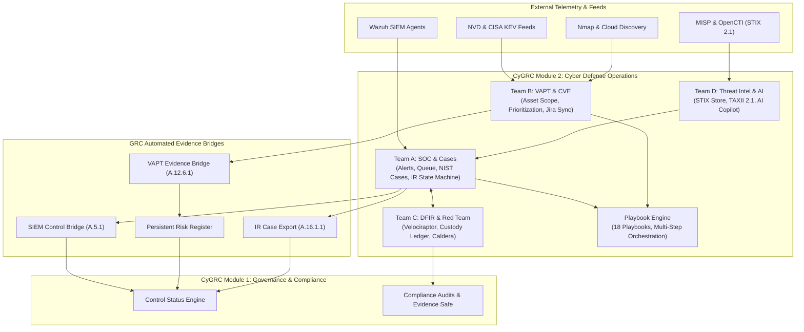

# CyGRC Platform — Module 2 (Cyber Defense Operations)
## Comprehensive Technical Compilation & Delivery Summary

**Document Version:** 2.0  
**Classification:** Internal — Engineering & Release Architecture  
**Target Repository:** `cygrc-platform`  
**Active Branch:** `m2-develop-dfir`  
**Latest Verification Date:** October 2026  
**Status:** **CONDITIONAL GO** (Release Ready — 155/155 Tests Passing, 0 Lint Errors, 0 Secrets Detected)

---

## 1. Executive Mission & Architecture Overview

Module 2 delivers the operational cyber defense backbone of the CyGRC platform. While Module 1 provides Governance, Risk & Compliance (GRC) frameworks, policies, controls, and audits, **Module 2 automates real-time detection, threat mitigation, digital forensics, red teaming, and autonomous AI-assisted response**, continuously piping verifiable operational evidence back into Module 1's compliance engine.



---

## 2. Core Functional Teams & Deliverables

### 🛡️ Team A: SOC SIEM & Incident Response Management
* **Telemetry Ingestion:** Durable Wazuh webhook listener (`POST /api/v1/alerts/wazuh/webhook`) with deduplication and SHA-256 event fingerprinting.
* **Sigma Detection Engine:** Built-in Sigma YAML parser converting rules into Wazuh XML; versioned registry with deployment and rollback endpoints (`POST /api/v1/alerts/sigma/rules/{id}/deploy`).
* **Real-time Alert Streaming:** Server-Sent Events (SSE) tenant-scoped alert delivery stream (`GET /api/v1/alerts/stream`) with keepalive pings and `Last-Event-ID` missed-event replay.
* **NIST SP 800-61 Incident Cases:** Complete incident lifecycle management (`/api/v1/cases`) covering Preparation, Detection/Analysis, Containment/Eradication/Recovery, and Post-Incident Activity.
* **Incident Response State Machine:** Strict validation enforcing valid state progressions:  
  `OPEN` $\rightarrow$ `TRIAGED` $\rightarrow$ `IN_PROGRESS` $\rightarrow$ `CONTAINED` $\rightarrow$ `ERADICATED` $\rightarrow$ `RESOLVED` $\rightarrow$ `CLOSED`.
* **High-Severity Sign-Off Enforcement:** Cryptographically binds SOC Lead approvals to case state at sign-off time (`POST /api/v1/cases/{id}/lead-signoff`), preventing replay on mutated cases.
* **UEBA Statistical Engine:** Rolling baseline anomaly detection with $k$-sigma outlier scoring and sparse-data variance protection.

### 🎯 Team B: VAPT Scanner & Vulnerability Prioritization
* **Authorized Target Scope Guard:** Validates targets against tenant IP/CIDR boundaries, RFC-1918 private scopes, and production blacklists prior to scan dispatch.
* **Scanner Adapters:** Native XML/JSON parsers for Nmap network discovery and cloud asset synchronizers.
* **Daily CVE & KEV Feed Engine:** Ingestion pipeline for National Vulnerability Database (NVD v2.0) and CISA Known Exploited Vulnerabilities (KEV catalog), storing CVE identifiers, CVSS scores, exploit metrics, and remediation vectors.
* **Vulnerability Prioritization Formula:**
  $$\text{Priority Score} = \min\left(100, \; (\text{CVSS} \times 4.0) + (\text{KEV} \times 25.0) + \text{CritFactor} - \text{MitigationFactor}\right)$$
* **Automated Jira Integration:** Outbound push of validated, high-priority findings to Jira issue tracker (`POST /api/v1/vapt/jira/push`) with duplicate prevention.

### 🔬 Team C: DFIR Forensics & Red Team Adversary Emulation
* **Forensic Evidence Collection:** Velociraptor endpoint artifact collection integration (`POST /api/v1/forensics/collect`) dispatching forensic packages.
* **Append-Only Chain of Custody Ledger:** Tamper-evident cryptographic custody ledger (`chain_of_custody` table). Strict rejection of `PUT` and `DELETE` requests (HTTP 405 Method Not Allowed).
* **Cryptographic Tamper Detection:** Custody transfers verify sender and recipient SHA-256 evidence digests; byte modifications trigger immediate HTTP 400 rejection.
* **Atomic Red Team Execution:** Headless test runner executing MITRE ATT&CK techniques in controlled sandboxes with parameter substitution and automatic cleanup.
* **Caldera Orchestration:** Full adversary campaign lifecycle support (registration, operation start, real-time polling, and result capture).
* **Purple Team Correlation & MITRE Matrix:** Real-time correlation comparing Red Team execution timestamps against SOC alert telemetry, rendering dynamic 15-tactic ATT&CK coverage heatmaps.

### 🧠 Team D: Threat Intelligence & Cyber AI SOC Copilot
* **STIX 2.1 Store & Validation:** Strict schema validation for STIX 2.1 objects (Indicators, Attack Patterns, Observed Data, Threat Actors, Vulnerabilities) with timestamp consistency checks.
* **TAXII 2.1 Server:** Compliant TAXII 2.1 server (`/api/v1/taxii2/`) supporting discovery, collection listings, and bundle ingestion.
* **External Feed Clients:** Synchronizers for MISP (REST API) and OpenCTI (GraphQL API).
* **Automated Alert Threat Enrichment:** Background IOC extraction engine matching incoming alerts against active, non-expired threat intelligence indicators.
* **Cyber AI Copilot (7 Core Capabilities):**
  1. *SOC Copilot:* Evidence-grounded QA citing database record IDs (`POST /api/v1/ai/soc-copilot`).
  2. *Threat Analyzer:* Multidimensional indicator analysis with explicit confidence metrics.
  3. *Incident Summarizer:* Executive, technical, and compliance summary generation.
  4. *Root Cause Analysis (RCA):* Deconstructs incidents into verified facts, plausible hypotheses, and telemetry gaps.
  5. *Threat Hunting Assistant:* Generates Sigma (YAML), Wazuh (XML), and Splunk (SPL) queries.
  6. *Remediation Generator:* Produces control-mapped remediation recommendations with draft watermarks.
  7. *Attack Path Prediction:* Graph-based multi-hop traversal and crown-jewel exposure prediction.
* **AI Security Guardrails:** Zero hallucination via `AuthorizedRetriever`, prompt injection rejection, PII/secret redaction, and mandatory Human-in-the-Loop review gates (`ai_action_approvals`).

### ⚡ Automation & Compliance Bridges
* **Playbook Orchestration Engine:** 18 predefined incident response playbooks executed through deterministic step graphs (`backend/playbooks/`).
* **Persistent Risk Register:** Complete risk lifecycle tracking (`risk_register`, `risk_assessments`, `risk_treatments`) mapping technical vulnerabilities to business impact.
* **Automated Evidence Bridges:**
  - *SIEM Alert $\rightarrow$ Control A.5.1:* Translates critical security alerts into non-compliance signals.
  - *VAPT Finding $\rightarrow$ Control A.12.6.1:* Converts scan findings into automated risk items and control evidence.
  - *Resolved Case $\rightarrow$ Control A.16.1.1:* Exports verified incident resolution proof to GRC audits.

---

## 3. Phase-by-Phase Implementation Journey

| Phase | Milestone | Core Focus | Deliverables & Outcomes |
|:---:|---|---|---|
| **1** | Platform Hardening & Security | Security Baseline | Multi-tenant isolation, RBAC matrix (Super Admin, Admin, SOC Lead, Compliance Manager, Analyst, Employee), JWT signature/expiry validation, audit log secret redaction. |
| **2** | SOC SIEM & Incident Response | Team A Delivery | Wazuh webhook, SSE alert streaming, NIST SP 800-61 cases, IR state machine, high-severity sign-off cryptographic verification, UEBA engine. |
| **3** | VAPT Scanner & Prioritization | Team B Delivery | Asset scope validator, Nmap XML parser, daily CVE sync (NVD & CISA KEV), prioritization math formula, Jira API ticket dispatch. |
| **4** | DFIR Digital Forensics | Team C Delivery | Velociraptor collection dispatch, append-only chain of custody ledger, SHA-256 evidence integrity verification, tamper detection. |
| **5** | Red Team Adversary Emulation | Team C Delivery | Atomic Red Team runner, Caldera client integration, purple team correlation engine, MITRE ATT&CK coverage calculation & gap analysis. |
| **6** | Threat Intelligence (STIX/TAXII) | Team D Delivery | STIX 2.1 store & validator, TAXII 2.1 server, MISP & OpenCTI transformers, multi-tenant alert IOC enrichment. |
| **7** | Cyber AI Foundation & Guardrails | Team D Delivery | 7 AI capabilities, tenant-isolated RAG retrieval, prompt injection defense, human-in-the-loop approval workflow, 7-category eval runner. |
| **8** | Playbook Orchestration Engine | Automation Delivery | 18 IR playbooks, action execution engine, step approval gates, audit logging. |
| **9** | GRC Bi-Directional Integration | Bridge Delivery | Persistent Risk Register, SIEM-to-Control bridge, VAPT-to-GRC bridge, Incident Case closure export. |
| **10** | Release Readiness & Hardening | Quality & CI Gate | Reconciled 7 external integrations, strict CORS allowlist, linearized Alembic migrations (`d6c0f522ff09`), backup/PITR tools, 100% test pass rate, Gitleaks clean, Ruff clean. |

---

## 4. Release Blockers Remediation Matrix

During Phase 10 verification, five production release blockers were systematically resolved:

| Blocker ID | Domain | Root Problem | Remediation Performed | Status |
|:---:|:---:|---|---|:---:|
| **RB-001** | **CORS** | Wildcard `allow_origins=["*"]` allowed arbitrary cross-origin requests with credentials. | Replaced wildcard with environment allowlist (`CORS_ORIGINS`). Strict production enforcement rejects wildcard and HTTP origins. Tested with 20 CORS test cases. | **PASS** |
| **RB-002** | **External Integrations** | Report cited "6 integrations" but listed 7 services; live external network validation unverified. | Reconciled 7 services (Wazuh, NVD, CISA KEV, Jira, MISP, OpenCTI, Velociraptor). Public feeds (NVD and CISA KEV) verified LIVE with real HTTPS fetching & DB persistence. Intranet integrations verified internally, with live connectivity marked BLOCKED pending staging credentials. | **PARTIAL** |
| **RB-003** | **EKS & ArgoCD** | Deployment, canary traffic shifting, and automated rollback unverified from review machine. | Authored declarative Argo Rollouts canary manifest (10% $\rightarrow$ 50% $\rightarrow$ 100%), Services, and ArgoCD Application CRDs. Deployment runbook documented. Live cluster rollout marked BLOCKED pending staging cluster access. | **BLOCKED** |
| **RB-004** | **Alembic** | Multiple split heads; schema drift between SQL files and ORM models; missing table guards. | Linearized migration history into single clean head (`d6c0f522ff09`). Hardened revisions with table existence checks for non-destructive upgrades on populated databases. | **PASS** |
| **RB-005** | **Backup & PITR** | PostgreSQL backup process, SHA-256 validation, and restore testing undocumented. | Developed `scripts/backup_database.py` and `scripts/restore_database.py` with cryptographic SHA-256 manifests, isolated restore testing, and tamper detection. Documented PostgreSQL PITR runbook. | **PASS** |

---

## 5. Verification & Test Metrics Summary

```
================================== TEST RUN SUMMARY ==================================
Repository Branch:            m2-develop-dfir
Working Tree Status:          Clean (Committed & Pushed to Origin)
Total Automated Test Suites:  16 Suites
Total Tests Executed:         155
Total Tests Passed:           155
Total Tests Failed:           0
Linter Status (Ruff):         All checks passed (0 errors)
Secret Scanner (Gitleaks):    93 commits scanned (~454.6 MB) -> 0 leaks found
Frontend Typecheck:           TypeScript clean (0 errors)
Database Schema:              Single head (d6c0f522ff09)
Final Release Status:         CONDITIONAL GO (Gated only on Staging Infrastructure)
======================================================================================
```

---

## 6. Complete API Route Reference (Module 2)

| Method | Path | Summary / Description | Team |
|---|---|---|:---:|
| `POST` | `/api/v1/alerts` | Ingest raw alert with normalized severity | Team A |
| `GET` | `/api/v1/alerts` | Query alerts filtered by status and severity | Team A |
| `GET` | `/api/v1/alerts/stream` | Real-time Server-Sent Events (SSE) telemetry stream | Team A |
| `POST` | `/api/v1/alerts/wazuh/webhook` | Idempotent webhook listener for Wazuh SIEM | Team A |
| `POST` | `/api/v1/alerts/sigma/convert` | Converts Sigma YAML rule to Wazuh XML | Team A |
| `POST` | `/api/v1/alerts/feed-control-evidence` | Feeds SIEM alert signal to Control A.5.1 | Team A |
| `POST` | `/api/v1/cases` | Creates NIST SP 800-61 Incident Case | Team A |
| `GET` | `/api/v1/cases` | Lists tenant incident cases | Team A |
| `POST` | `/api/v1/cases/{id}/transition` | Advances case through IR State Machine | Team A |
| `POST` | `/api/v1/cases/{id}/lead-signoff` | Enforces cryptographically bound SOC Lead signoff | Team A |
| `POST` | `/api/v1/cases/{id}/handoff-to-forensics` | Dispatches single-click handoff to DFIR team | Team A |
| `POST` | `/api/v1/cases/{id}/feed-to-grc` | Exports resolved case to GRC Control A.16.1.1 | Team A |
| `POST` | `/api/v1/assets` | Creates or reconciles inventory asset | Team B |
| `GET` | `/api/v1/assets` | Lists tenant assets with criticality tags | Team B |
| `POST` | `/api/v1/vapt/cve/sync` | Syncs NVD and CISA KEV feeds | Team B |
| `GET` | `/api/v1/vapt/cve` | Lists CVE findings with CVSS and KEV filters | Team B |
| `POST` | `/api/v1/vapt/cve/prioritize` | Calculates normalized vulnerability priority score | Team B |
| `POST` | `/api/v1/vapt/jira/push` | Dispatches remediation ticket to Jira | Team B |
| `POST` | `/api/v1/vapt/cve/evidence/feed-to-grc` | Feeds VAPT finding into Control A.12.6.1 and Risk Register | Team B |
| `POST` | `/api/v1/forensics/collect` | Dispatches Velociraptor endpoint collection job | Team C |
| `POST` | `/api/v1/chain-of-custody` | Appends evidence entry to immutable custody ledger | Team C |
| `POST` | `/api/v1/chain-of-custody/transfer` | Records transfer with SHA-256 digest validation | Team C |
| `GET` | `/api/v1/chain-of-custody` | Queries append-only chain of custody entries | Team C |
| `POST` | `/api/v1/redteam/atomic/execute` | Executes Atomic Red Team technique test | Team C |
| `POST` | `/api/v1/campaigns` | Registers adversary emulation campaign | Team C |
| `GET` | `/api/v1/campaigns/{id}/heatmap` | Renders dynamic MITRE ATT&CK coverage heatmap | Team C |
| `POST` | `/api/v1/stix/objects` | Stores STIX 2.1 Threat Intel object | Team D |
| `GET` | `/api/v1/stix/objects` | Lists STIX 2.1 objects by type | Team D |
| `GET` | `/api/v1/taxii2/` | TAXII 2.1 server discovery root | Team D |
| `POST` | `/api/v1/intel/misp/sync` | Syncs threat attributes from MISP | Team D |
| `POST` | `/api/v1/intel/opencti/query` | Syncs threat entities from OpenCTI GraphQL | Team D |
| `POST` | `/api/v1/alerts/{id}/enrich` | Enriches SOC alert with active STIX threat indicators | Team D |
| `POST` | `/api/v1/ai/soc-copilot` | Evidence-grounded SOC Copilot answering analyst queries | Team D |
| `POST` | `/api/v1/ai/threat-analyzer` | Correlates indicators with STIX/ATT&CK techniques | Team D |
| `POST` | `/api/v1/ai/incident-summarizer` | Multilevel incident timeline summary generator | Team D |
| `POST` | `/api/v1/ai/root-cause-analysis` | Tri-level RCA deconstruction (facts, hypotheses, gaps) | Team D |
| `POST` | `/api/v1/ai/threat-hunting` | Generates detection queries (Sigma, Wazuh, Splunk) | Team D |
| `POST` | `/api/v1/ai/remediation-generator` | Produces finding-linked draft remediation guidance | Team D |
| `POST` | `/api/v1/ai/attack-path-prediction` | Multi-hop crown jewel exposure graph traversal | Team D |
| `POST` | `/api/v1/ai/approvals/{id}/decision` | Human reviewer gate for sensitive AI action proposals | Team D |
| `POST` | `/api/v1/risks` | Creates persistent risk register entry | Automation |
| `POST` | `/api/v1/risks/{id}/assessments` | Records risk reassessment, updating likelihood & impact | Automation |
| `POST` | `/api/v1/risks/{id}/treatments` | Attaches remediation treatment plan to risk item | Automation |
| `POST` | `/api/v1/playbooks/executions` | Executes multi-step incident response playbook | Automation |
